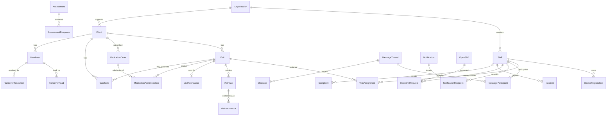

# WellTrust Carer Backend Implementation Guide

**Target backend:** ASP.NET Core Web API  
**Source reviewed:** the current Flutter UI, models, providers, services, and tests  
**Review date:** 1 October 2026  
**API prefix used by the app:** `/api`

## 1. Purpose

This document translates the mobile app's UI and data flow into a backend contract. It is intended to let the backend team build the APIs and business rules needed by the WellTrust Carer app without having to reverse-engineer the Flutter code.

The app is a care-worker application. Its main navigation is:

1. **Today** — today's round, next visit, clock-in, running-late alert, meeting reminder.
2. **Visits** — weekly rota and visit details.
3. **Handover** — client-specific information, concerns, follow-ups, and read state.
4. **Notes** — care notes written during or outside a visit.
5. **More** — open shifts, hours, assessments, incidents, complaints, staff records, settings, and sign-out.

The global header also exposes **Messages**, **Meetings**, and **Notifications**.

### Contract status used below

- **Existing** means the Flutter app already calls this route. Preserve its path and JSON shape unless the mobile client is changed with it.
- **Required** means the UI exists but currently uses in-memory/sample state. The backend should implement it.
- **Future** means the UI hints at the capability, but it is not required for the first usable backend release.

## 2. Current state of the mobile app

### Already backed by HTTP

- Kiosk/staff login, refresh, logout, and FCM token update.
- Staff profile and staff self-service records.
- File upload.
- Notifications list.
- Feedback.

### Currently local or sample data only

- Clients visible to the carer.
- Rota and visits.
- Clock-in/out, task completion, and running-late reports.
- Medication list and medication administration.
- Handovers, unread state, and follow-up resolution.
- Care notes.
- Messages and replies.
- Meetings and minutes/live listening.
- Open shift requests.
- Worked hours.
- Assessments and drafts.
- Incident reports and complaints.

These local areas must be server-backed before production. At present, app restart loses their changes and sample client data is reused across screens.

## 3. Recommended ASP.NET solution structure

Use a modular monolith first; it is simpler to operate and still provides clear boundaries.

```text
src/
  WellTrust.Api/              Controllers/endpoints, auth, middleware
  WellTrust.Application/      Commands, queries, validation, DTO mapping
  WellTrust.Domain/           Entities, enums, policies, domain events
  WellTrust.Infrastructure/   EF Core, file storage, FCM, email, SignalR
tests/
  WellTrust.UnitTests/
  WellTrust.IntegrationTests/
```

Recommended platform components:

- ASP.NET Core Web API on the supported .NET LTS version.
- Entity Framework Core with SQL Server or PostgreSQL.
- ASP.NET Core Identity or the existing identity store, issuing JWT access tokens.
- Rotating refresh tokens stored as hashes.
- FluentValidation or endpoint-level validation.
- OpenAPI/Swagger with bearer authentication.
- SignalR for live message, handover, rota, meeting, and notification updates.
- Firebase Admin SDK for push notifications.
- Object storage for documents; the API should return a stable URL or protected download identifier.
- Background jobs for reminders, expiry alerts, email, and FCM retries.

Do not split this into microservices initially. Visits, handovers, medication, and notes share transactions, permissions, and audit requirements.

### Current deployment configuration to correct

The Flutter endpoint helper currently points `production`, `live`, and `test` at the same host:

```text
https://new-api-connection.welltrustcare.co.uk/
```

It builds REST URLs under `/api/` and a WebSocket URL at `/ws`. Before release, provide separate test/staging/production hosts and data stores, and make the mobile build fail clearly when an unknown environment is selected. Test data and credentials must never share the production database.

## 4. Tenant and authorization model

Every care-domain record must belong to an organisation/tenant, even if the current mobile JSON does not expose `organisationId`.

Minimum roles:

| Role | Typical access |
|---|---|
| `Carer` | Own profile, assigned clients/visits, own submissions, permitted client care data |
| `Coordinator` | Rota, visit monitoring, handover follow-ups, incidents, open shifts |
| `Manager` | Organisation-wide care and staff management |
| `Admin` | User/device configuration and operational administration |

Authorization must be enforced from token claims and database relationships, not from a submitted `staffId` or `adminStaffId` alone.

Important object-level rules:

- A carer can only read a client when assigned through the current/relevant rota, key-worker relationship, or explicit access grant.
- A carer can only clock into a visit assigned to them.
- A carer cannot edit the rota.
- Access codes and key-safe details are only returned for an authorized upcoming/in-progress visit and must never appear in logs or push payloads.
- Handovers and care notes are append-only for carers. Corrections should create an amendment with author, timestamp, and reason.
- The server derives `createdByStaffId`, `organisationId`, and submission times from the authenticated request.
- Staff may update only their own allowed profile fields. Pay, supervision, probation, declarations, appointment details, and established compliance records remain office-managed.

## 5. Cross-cutting API conventions

### 5.1 URLs and JSON

- Base path: `/api`.
- Use plural resource names for new routes.
- JSON uses `camelCase`, matching Flutter.
- IDs should be opaque UUID strings.
- Instants use ISO 8601 UTC, for example `2026-10-01T09:30:00Z`.
- Date-only values use `yyyy-MM-dd`.
- Store the organisation's IANA time zone, for example `Europe/London`; do not derive visit dates using server-local time.
- Phone numbers should be stored in E.164 where possible.
- Monetary values use decimal columns, never floating point.

### 5.2 Standard responses

For new list endpoints:

```json
{
  "items": [],
  "page": 1,
  "pageSize": 25,
  "totalCount": 0,
  "nextCursor": null
}
```

For errors, return RFC 9457 `ProblemDetails`:

```json
{
  "type": "https://api.welltrustcare.co.uk/problems/visit-already-active",
  "title": "Another visit is already active",
  "status": 409,
  "detail": "Finish the current visit before starting another.",
  "code": "visit_already_active",
  "traceId": "00-...",
  "errors": {}
}
```

The app currently treats both `200` and `201` as success. For new APIs use conventional status codes:

- `200 OK` for reads and updates.
- `201 Created` for creates, with a `Location` header.
- `204 No Content` for successful no-body actions/deletes.
- `400` validation failure.
- `401` invalid/expired authentication.
- `403` authenticated but not permitted.
- `404` not found or deliberately hidden from this caller.
- `409` state conflict or duplicate action.
- `422` valid JSON that violates a workflow rule.
- `429` throttled.

### 5.3 Idempotency and concurrency

Mobile connections are unreliable; a timeout can occur after the server saved an action.

- Accept `Idempotency-Key` on every create/action POST.
- Scope keys to authenticated user + route and retain results for at least 24 hours.
- Add `rowVersion`/ETag to mutable resources such as visit assignment, assessment draft, incident workflow, and staff records.
- Return `409` or `412` for stale updates.
- Never toggle state through an endpoint. Send the desired state (`completed: true`) or create an immutable event.

### 5.4 Audit

Record at minimum:

- actor user/staff ID and role;
- tenant ID;
- action and entity type/ID;
- UTC server time;
- request correlation ID and device ID;
- before/after values for administrative changes;
- submitted device time where useful, kept separate from server time;
- location consent/result for visit attendance events;
- source IP and user agent, subject to retention policy.

Audit records must be append-only and must redact PINs, JWTs, refresh tokens, key-safe codes, bank details, and unnecessary health text.

## 6. Domain model



Core entity guidance:

| Entity | Key data |
|---|---|
| `Client` | name/preferred name, phone, address, latitude/longitude, alerts, active status |
| `Visit` | client, planned start/end, type, address snapshot, access details, status, revision |
| `VisitAssignment` | visit, staff, assignment role, accepted/acknowledged time |
| `VisitTask` | label, order, category, medication-order link if applicable, required flag |
| `VisitAttendance` | clock-in/out server/device times, location, accuracy, distance, timing reason, flags |
| `CareNote` | client, optional visit, structured observations, text, office flag, author |
| `Handover` | client, kind, priority, text, structured details, follow-up data, immutable author/time |
| `MedicationAdministration` | order, visit, outcome, dose/time, staff, reason/note, audit data |
| `Incident` / `Complaint` | generated reference, submitted facts, workflow status, assignee |

Avoid storing handover `details` only as an unqueryable JSON blob. Either use columns for the known categories or a child key/value table plus validated category codes.

## 7. Existing endpoints that must remain compatible

### 7.1 Authentication

| Method and route | Auth | Contract |
|---|---|---|
| `POST /api/welltrust-kiosk/login` | Anonymous | Existing kiosk login |
| `POST /api/auth/tokens/refresh` | Refresh token | Existing refresh |
| `POST /api/auth/logout` | Bearer | Revoke current session/refresh token |
| `PUT /api/admin-users/update-device-token` | Bearer | Register current FCM token |
| `DELETE /api/admin-users/{userId}` | Bearer | Existing account-deletion call; enforce self/role rules and retention policy |

Login request (the UI requires a username and exactly five numeric PIN digits):

```json
{
  "username": "j.jones",
  "passcode": "12345"
}
```

Compatible login response:

```json
{
  "token": "jwt-access-token",
  "refreshToken": "opaque-refresh-token",
  "refreshTokenExpiryTime": "2026-10-31T12:00:00Z",
  "staffId": "7da23c5d-...",
  "staffName": "John Jones",
  "username": "j.jones",
  "email": "john@example.com",
  "userType": "Staff",
  "roles": ["Carer"],
  "permissions": ["visits.read", "visits.clock", "handover.write"],
  "deviceId": "...",
  "deviceName": "Office iPhone 3",
  "deviceReferenceNumber": "KIOSK-003"
}
```

The client accepts `userId`/`fullName` or `staffId`/`staffName`, but the backend should choose one canonical shape and document it. Keep aliases during migration.

Refresh request currently sent by the app:

```json
{
  "username": "j.jones",
  "email": "john@example.com",
  "refreshToken": "opaque-refresh-token"
}
```

Device-token request currently sent by the app:

```json
{ "deviceToken": "fcm-registration-token" }
```

Security rules:

- Store PINs using a slow password hash; never encrypt or log the clear PIN.
- Apply account/device status checks and rate limiting.
- The current UI expects `401` to avoid revealing whether username, PIN, device assignment, or device status was wrong.
- Rotate refresh tokens on every use and detect reuse.
- Logout revokes the presented refresh-token family.
- Account deletion must not physically erase authored care/MAR/audit records. Deactivate or pseudonymise according to the agreed retention process and revoke every session/device token.

### 7.2 Staff profile and records

| Method and route | Purpose |
|---|---|
| `GET /api/admin-users/profile` | Own complete profile |
| `PUT /api/admin-users/update` | Update allowed core profile fields |
| `POST /api/admin-staff-records/{segment}` | Add/set own record |
| `PUT /api/admin-staff-records/{segment}/{id}` | Update own list record |
| `DELETE /api/admin-staff-records/{segment}/{id}` | Delete own list record |
| `GET /api/admin-staff-records/{segment}/staff/{staffId}` | Read staff records in one area |
| `POST /api/admin-staff-records/references/{id}/send-request` | Email referee and update status |

Segments used by the app:

```text
profile
emergency-contact
documents
qualifications
certificates
competencies
references
compliance
supervisions
probation (the app currently falls back to probations)
declarations
```

The profile response includes core fields plus `profile`, `compliance`, `employmentPay`, `emergencyContact`, `qualifications`, `certificates`, `competencies`, `documents`, and `appointmentLetter`. References, supervisions, probation, and declarations are loaded separately.

Important compatibility rules:

- `PUT /admin-users/update` is a patch-like update even though it uses PUT: omitted/null-unsent fields retain existing values.
- The client sends `bankSortCode`; a `bankCode` alias is not sufficient.
- `profile`, `emergency-contact`, and `compliance` are singleton resources.
- A carer may create compliance once; after that only the office may change it.
- A POST currently includes `adminStaffId`, but the API must verify it equals the authenticated staff record.
- A record area with no data may return `200 []` or `204`; prefer `200 []` consistently.

Writable staff-record payloads are defined in Appendix A.

### 7.3 Uploads

`POST /api/upload-files/upload-web-server` is `multipart/form-data`:

- file field name: `Image` (even for PDF/document uploads);
- text field: `Folder`;
- accepted current folder values: `images`, `videos`, `cvs`, `documents`, `certificates`, `files`.

Success response:

```json
{ "imageUrl": "/uploads/documents/2e4f....pdf" }
```

The backend must validate actual file signature, extension, MIME type, size, malware status, tenant ownership, and authorization. Generate the final storage name server-side. Prefer protected downloads or short-lived signed URLs for staff and care documents.

### 7.4 Notifications and feedback

Existing calls:

- `GET /api/notifications`
- `GET /api/notifications/{id}`
- `POST /api/notifications` (legacy sending path; should be restricted to office roles)
- `POST /api/info/feedback`

The existing notification shape is:

```json
{
  "id": "...",
  "userId": "...",
  "title": "Rota changed",
  "body": "Your Friday visit has changed.",
  "deviceToken": null,
  "notificationType": "rota.changed",
  "imageUrl": null,
  "createdAt": "2026-10-01T08:20:00Z",
  "updatedAt": "2026-10-01T08:20:00Z"
}
```

Do not expose `deviceToken` in read responses. The server should filter notifications to the authenticated user; the client currently filters again, but that is not a security boundary.

## 8. Required care APIs

The paths below are the recommended contract for features that are currently local. They can be adjusted before mobile integration, but all listed data and rules are required.

### 8.1 Bootstrap and organisation configuration

`GET /api/mobile/bootstrap`

Return small, frequently used configuration after login:

```json
{
  "serverTimeUtc": "2026-10-01T08:00:00Z",
  "organisation": {
    "id": "...",
    "name": "WellTrust Care",
    "timeZone": "Europe/London",
    "officePhone": "+441536555010"
  },
  "staff": {
    "id": "...",
    "displayName": "John Jones"
  },
  "rules": {
    "clockInWindowMinutes": 120,
    "clockInGraceMinutes": 15,
    "clockInDistanceThresholdMetres": 400,
    "locationRequired": true
  },
  "syncCursor": "opaque-cursor"
}
```

This removes hard-coded office numbers and operational thresholds from the app.

### 8.2 Clients accessible to the carer

| Method and route | Purpose |
|---|---|
| `GET /api/clients?scope=today|assigned&date=yyyy-MM-dd` | Authorized client summaries |
| `GET /api/clients/{clientId}` | Client detail if caller has access |

Client summary/detail must support:

```json
{
  "id": "...",
  "name": "Mr Harold Fisher",
  "preferredName": "Harold",
  "phone": "+447700900101",
  "address": {
    "display": "14 Rowan Close, Kettering",
    "latitude": 52.3975,
    "longitude": -0.7395
  },
  "alerts": [
    { "id": "...", "category": "falls", "text": "Falls risk.", "severity": "warning" }
  ],
  "nextVisit": {
    "id": "...",
    "plannedStart": "2026-10-01T08:00:00Z"
  }
}
```

Do not put access codes in the general client response.

### 8.3 Rota and visits

| Method and route | Purpose |
|---|---|
| `GET /api/me/rota?from=...&to=...` | Weekly/today rota for signed-in carer |
| `GET /api/visits/{visitId}` | Full authorized visit details |
| `POST /api/visits/{visitId}/acknowledge-change` | Acknowledge a revised rota item |
| `POST /api/visits/{visitId}/running-late` | Notify office of delay |

Rota item response:

```json
{
  "id": "...",
  "revision": 4,
  "changed": true,
  "status": "scheduled",
  "plannedStart": "2026-10-01T11:00:00Z",
  "plannedEnd": "2026-10-01T11:45:00Z",
  "durationMinutes": 45,
  "travelMinutesFromPrevious": 12,
  "visitType": "lunch_call",
  "client": {
    "id": "...",
    "name": "Mrs Margaret Hensley",
    "preferredName": "Margaret",
    "address": "3 Elm Court, Kettering"
  },
  "coWorkers": [
    { "staffId": "...", "displayName": "Sarah Williams" }
  ],
  "hasUnreadHandover": true,
  "attendanceStatus": "not_started"
}
```

Full visit detail adds phone, location, access type/code/note, things-to-know alerts, tasks, medications due, and current attendance/task state.

Running-late request:

```json
{
  "estimatedDelayMinutes": 20,
  "reason": "Traffic on the A14",
  "deviceOccurredAt": "2026-10-01T10:50:00Z"
}
```

Allowed UI delays are currently 10, 20, 30, 45, and 60 minutes. The server creates an office notification and audit entry. Calling the client remains a phone action, not proof they were contacted.

### 8.4 Clock-in, tasks, and clock-out

| Method and route | Purpose |
|---|---|
| `POST /api/visits/{visitId}/clock-in` | Start attendance |
| `PUT /api/visits/{visitId}/tasks/{taskId}` | Set task outcome |
| `POST /api/visits/{visitId}/clock-out` | Finish attendance |
| `GET /api/visits/{visitId}/attendance` | Restore state after restart |

Clock-in request:

```json
{
  "deviceOccurredAt": "2026-10-01T10:58:14+01:00",
  "atClientHome": true,
  "timingReason": null,
  "location": {
    "latitude": 52.39749,
    "longitude": -0.73948,
    "accuracyMetres": 18.2
  },
  "clientReportedDistanceMetres": 12.4,
  "continuedDespiteDistanceWarning": false,
  "deviceId": "..."
}
```

The server must:

1. Verify the visit is assigned to the caller and is not cancelled/completed.
2. Enforce only one active visit for a carer. Use a transaction/unique constraint, not a prior read only.
3. Enforce the configured clock-in window (the UI currently uses ±120 minutes from planned start).
4. Require `timingReason` more than 15 minutes early or late.
5. Recalculate distance from stored client coordinates; never trust the submitted distance.
6. Flag a claimed-at-home clock-in beyond 400 metres (configurable), low-accuracy locations, and missing location.
7. Store both device time and authoritative server receipt time.
8. Return the complete attendance state so a retry or second device converges.

Clock-in response:

```json
{
  "visitId": "...",
  "status": "in_progress",
  "clockedInAt": "2026-10-01T09:58:16Z",
  "distanceFromClientMetres": 13.1,
  "flags": [],
  "rowVersion": "AAAAAAAAB9E="
}
```

Task update:

```json
{
  "outcome": "completed",
  "note": null,
  "deviceOccurredAt": "2026-10-01T11:12:00+01:00",
  "rowVersion": "AAAAAAAAB9E="
}
```

Recommended task outcomes: `pending`, `completed`, `not_completed`, `refused`, `not_applicable`. Medication tasks may only become complete through a medication-administration record.

Clock-out request:

```json
{
  "deviceOccurredAt": "2026-10-01T11:43:00+01:00",
  "unfinishedTaskReason": null,
  "location": {
    "latitude": 52.39749,
    "longitude": -0.73948,
    "accuracyMetres": 22.0
  },
  "rowVersion": "AAAAAAAAB9E="
}
```

Decide with care operations whether all required tasks must have an outcome before clock-out. Do not silently mark unfinished tasks completed.

### 8.5 Medication/MAR

The UI currently displays medication name, dose/instruction, route, food instruction, and scheduled time, then offers “Sign as given”. This must not be implemented as a boolean task toggle.

| Method and route | Purpose |
|---|---|
| `GET /api/visits/{visitId}/medications` | Medication rounds relevant to visit window |
| `POST /api/visits/{visitId}/medication-administrations` | Record an immutable MAR event |
| `GET /api/clients/{clientId}/mar?from=...&to=...` | Authorized MAR history |

Administration request:

```json
{
  "medicationOrderId": "...",
  "scheduledDoseId": "...",
  "outcome": "given",
  "administeredAt": "2026-10-01T11:08:00+01:00",
  "doseGiven": "500 mg",
  "note": null,
  "reasonCode": null
}
```

Support at least `given`, `refused`, `not_available`, `withheld`, `omitted`, and `other`. Non-given outcomes require a reason/note and may trigger an office alert. Corrections must be separate signed amendment events.

### 8.6 Care notes

| Method and route | Purpose |
|---|---|
| `GET /api/care-notes?clientId=...&visitId=...&from=...&to=...` | Authorized notes |
| `POST /api/care-notes` | Add a note |
| `POST /api/care-notes/{id}/amendments` | Correct without overwriting history |

Create request matching the current form:

```json
{
  "clientId": "...",
  "visitId": null,
  "mood": "settled",
  "foodAndDrink": "good",
  "skinAndComfort": "no_concerns",
  "text": "Helped Harold wash and dress...",
  "flagForOffice": false,
  "deviceOccurredAt": "2026-10-01T12:20:00+01:00"
}
```

Validation and rules:

- All structured observations and text are required by the current UI.
- Text maximum is 1,000 characters.
- Mood values: `settled`, `low`, `anxious`, `unwell`.
- Intake values: `good`, `some`, `little`, `refused`, `not_needed`.
- Skin values: `no_concerns`, `concern`.
- `skinAndComfort=concern` forces `flagForOffice=true` server-side.
- Visit-generated notes include `visitId`; outside-visit notes may leave it null.
- A flagged note creates an office task/notification in the same transaction/outbox flow.

### 8.7 Handover

| Method and route | Purpose |
|---|---|
| `GET /api/handovers?scope=today|assigned|flagged&clientId=...` | Handover feed |
| `POST /api/handovers` | Add immutable handover |
| `POST /api/clients/{clientId}/handovers/read` | Mark through a server watermark |
| `POST /api/handovers/{id}/resolve` | Resolve follow-up/open concern |

Create request:

```json
{
  "clientId": "...",
  "visitId": null,
  "kind": "concern",
  "priority": "urgent",
  "text": "Harold ate very little at lunch...",
  "details": {
    "mood": "low",
    "foodAndDrink": "little",
    "medication": "no_issues",
    "skinAndMobility": null,
    "homeAndEquipment": null,
    "familyContact": null
  },
  "needsFollowUp": true,
  "followUpFor": "next_carer",
  "followUpDueDate": "2026-10-02"
}
```

Enums required by the UI:

- kind: `info`, `concern`, `change`, `todo`, `visit_summary`;
- priority: `routine`, `important`, `urgent`;
- follow-up audience: `next_carer`, `office`, `anyone`.

Text max is 1,000; optional home/equipment and family-contact text max is 160 each.

Unread handling should use a per-user/per-client watermark:

```json
POST /api/clients/{clientId}/handovers/read
{ "readThrough": "2026-10-01T11:59:10Z" }
```

Only entries by someone other than the reader and newer than the watermark count as unread. Return `unreadCount` with client/feed summaries.

Resolution request:

```json
{
  "completionNote": "Called the office and GP review arranged.",
  "deviceOccurredAt": "2026-10-01T13:05:00+01:00"
}
```

Completion note max is 500. The server sets resolver and resolved time. A resolved handover remains visible; it is never deleted.

### 8.8 Messages

| Method and route | Purpose |
|---|---|
| `GET /api/message-threads?cursor=...` | Threads and unread state |
| `POST /api/message-threads` | Compose to Management/Admin/Office queue |
| `GET /api/message-threads/{id}` | Thread with messages |
| `POST /api/message-threads/{id}/messages` | Reply |
| `POST /api/message-threads/{id}/read` | Mark read through message |

New-thread request:

```json
{
  "recipientQueue": "office",
  "subject": "Question about Friday rota",
  "body": "Please can someone confirm..."
}
```

Current UI limits are 80 characters for subject, 2,000 for a new message, and 1,000 for a reply. Recipients shown are `management`, `admin`, and `office`; map these to managed queues/roles, not arbitrary display strings.

Thread summaries need `id`, `party`, `subject`, `lastMessage`, `lastAt`, `unreadCount`, and optional deep link data such as `{ "type": "rota" }`.

Messages are not an emergency channel. Preserve that warning in backend/admin workflows and define office response expectations operationally.

### 8.9 Meetings

| Method and route | Purpose |
|---|---|
| `GET /api/meetings?from=...&to=...` | Upcoming/past accessible meetings |
| `GET /api/meetings/{id}` | Agenda, live state, and published minutes |
| `POST /api/meetings/{id}/attendance` | Optional listen/join/leave audit |
| `GET /api/meetings/{id}/listen-token` | Short-lived listen-only media token |

Return title, start/end, host, location, cancelled status, agenda, published minutes, decisions, and actions (`action`, `owner`, optional `due`). Do not return a live token until the meeting is live and the caller is authorized. The current UX is listen-only and must not grant microphone/publish permissions.

### 8.10 Notifications

Add server-side read state:

| Method and route | Purpose |
|---|---|
| `GET /api/notifications?unreadOnly=false&cursor=...` | Own notifications only |
| `POST /api/notifications/{id}/read` | Mark one read |
| `POST /api/notifications/read-all` | Mark all/read-through |
| `POST /api/devices` | Upsert FCM device registration |
| `DELETE /api/devices/{deviceId}` | Revoke device on logout/removal |

Recommended notification response adds:

```json
{
  "id": "...",
  "title": "New urgent handover",
  "body": "Review before your next visit.",
  "notificationType": "handover.urgent",
  "priority": "urgent",
  "createdAt": "2026-10-01T08:20:00Z",
  "readAt": null,
  "deepLink": { "type": "handover", "clientId": "...", "handoverId": "..." }
}
```

Push payloads should contain only IDs, type, and safe preview text. The app must fetch protected detail after opening.

### 8.11 Open shifts and requests

| Method and route | Purpose |
|---|---|
| `GET /api/open-shifts?from=...&to=...` | Published available shifts plus clash result |
| `POST /api/open-shifts/{id}/requests` | Ask for shift |
| `DELETE /api/open-shifts/{id}/requests/mine` | Withdraw pending request |
| `GET /api/open-shift-requests/mine` | Restore request status |

Shift response includes start/end, run name, note, visit count/double-up summary, `requestStatus`, and optional `clash` with the conflicting assigned visit. Recheck clashes and availability transactionally when creating a request. A request does not alter the rota until office approval.

Suggested statuses: `pending`, `approved`, `declined`, `withdrawn`, `expired`.

### 8.12 Hours

`GET /api/me/hours?from=...&to=...&groupBy=day|week`

Derive worked time from accepted attendance records, not client totals. Return each visit's planned and actual times/durations plus totals. Keep any payroll approval/adjustment separate and audited.

### 8.13 Assessments

| Method and route | Purpose |
|---|---|
| `GET /api/assessments?status=assigned|draft|submitted` | Assigned assessments |
| `GET /api/assessments/{id}` | Definition plus current response |
| `PUT /api/assessments/{id}/draft` | Upsert draft |
| `POST /api/assessments/{id}/submit` | Validate and lock submission |

The current assessment has review date, seven care areas, per-area rating and notes, overall summary, confirmation, due date, and submission time. Ratings are `no_concerns`, `some_concerns`, `urgent_concern`. Concern ratings require a note; all areas, summary, and confirmation are required on submit. Drafts may be incomplete. Submitted responses become immutable except through a managed amendment/reopen process.

### 8.14 Incidents

| Method and route | Purpose |
|---|---|
| `GET /api/incidents/mine?from=...&to=...` | Reports submitted by caller |
| `POST /api/incidents` | Submit incident |
| `GET /api/incidents/{id}` | Authorized detail/status |

Request:

```json
{
  "occurredAt": "2026-10-01T10:15:00+01:00",
  "type": "fall",
  "clientId": "...",
  "visitId": "...",
  "place": "client_home",
  "severity": "high",
  "description": "...",
  "immediateAction": "Checked for injury and called the office.",
  "officeInformed": true
}
```

Supported types shown in the fuller UI: fall, medication concern, safeguarding concern, injury/illness, missed/late visit, could not get in, equipment fault, property damage, near miss, other. Places: client home, travel, office, elsewhere. Severity: low, medium, high.

Rules:

- Occurrence cannot be materially in the future.
- Type, place, severity, description, immediate action, and office-informed answer are required.
- Client is optional because some incidents concern staff/travel; visit is optional.
- Generate the reference atomically server-side, e.g. `INC-20261001-001`. Do not count rows in application memory.
- High severity/safeguarding/medication categories trigger an urgent coordinator workflow and notification.
- Return the generated reference and submission/status fields.

There are currently two incident forms in the Flutter UI with slightly different fields. The backend should implement the superset above, and the mobile app should converge both entry points onto it.

### 8.15 Complaints

| Method and route | Purpose |
|---|---|
| `GET /api/complaints/mine?from=...&to=...` | Complaints recorded by caller |
| `POST /api/complaints` | Record complaint/concern |
| `GET /api/complaints/{id}` | Authorized status/detail |

Create fields: `raisedBy`, optional `clientId`, `category`, `occurredDate`, and `details`. Raised-by values are supported person, relative/visitor, colleague, other. Categories are quality of care, late/missed visit, staff conduct, communication, other. Generate a server reference such as `CMP-20261001-001` and retain workflow status/assignee separately from the submitted facts.

## 9. Workflow state machines

### Visit

```text
Scheduled -> InProgress -> Completed
    |            |
    +-> Cancelled+-> Exception/RequiresReview
```

- `upcoming`, `due`, and `overdue` are UI projections calculated from schedule + attendance, not necessarily stored statuses.
- A missed visit remains scheduled/exception until reviewed; it must not become completed automatically.
- Rota revisions should preserve previous assignment/schedule history.

### Handover follow-up

```text
Open -> Resolved
```

The original text is immutable. Resolution adds resolver, time, and optional note.

### Open shift request

```text
Pending -> Approved | Declined | Withdrawn | Expired
```

Approval must transactionally create/update assignment and recheck clashes.

### Assessment

```text
Assigned -> Draft -> Submitted -> Reviewed
```

### Incident/complaint

```text
Submitted -> Acknowledged -> Investigating -> Closed
```

Any reopen should be an audited transition.

## 10. Events, real-time updates, and notifications

Use an outbox table so the business write and event publication are committed together.

Useful domain events:

- `RotaChanged`
- `VisitClockedIn`, `VisitClockedOut`, `VisitAttendanceFlagged`
- `CarerRunningLate`
- `CareNoteFlagged`
- `HandoverCreated`, `UrgentHandoverCreated`, `HandoverResolved`
- `MedicationNotGiven`
- `MessageCreated`
- `MeetingStarting`
- `DocumentExpiring`
- `OpenShiftRequestChanged`
- `IncidentSubmitted`, `ComplaintSubmitted`

SignalR delivers immediate in-app changes when connected. FCM is a wake-up/attention channel. Database state remains authoritative; clients must refetch after an event.

## 11. Offline and sync behavior

The current app mostly requires connectivity, but carers can lose signal in homes. The backend contract should be safe for a later offline queue:

- every mutation accepts an idempotency key and device occurrence time;
- responses include server time and canonical state;
- mutable records carry a version;
- list feeds support `updatedSince` or an opaque sync cursor;
- deletes use tombstones where clients need to synchronize them;
- conflicts never overwrite care records silently;
- clock-in/out received late are flagged for review rather than discarded without trace.

For the first release, it is acceptable for the UI to require connectivity for sensitive writes, but the server must still be retry-safe.

## 12. Security and privacy requirements

This system contains health, safeguarding, location, employment, identity, and bank information.

- TLS only; enable HSTS outside development.
- Encrypt database/storage and managed secrets at rest.
- Never log request bodies for login, access details, care notes, MAR, incidents, bank data, or uploaded documents.
- Use field-level or dedicated secrets protection for key-safe/access codes.
- Do not cache sensitive API responses in shared proxies.
- Apply least privilege to database, object storage, FCM, and email credentials.
- Scan uploads and prevent executable/publicly enumerable files.
- Rate-limit authentication, messages, uploads, and report creation.
- Revoke all device registrations and refresh tokens when an account/device is disabled.
- Define retention, legal hold, subject-access/export, and deletion/anonymisation policies with the organisation's governance lead.
- Preserve clinical/audit records when a user account is deactivated; do not cascade-delete authored care history.
- Alert on repeated distant clock-ins, missing locations, refresh-token reuse, mass record access, and unusual downloads.

## 13. Database constraints worth enforcing

- Unique active attendance per staff member (filtered/partial unique index).
- Unique attendance per visit assignment unless a deliberate re-open workflow exists.
- Unique medication administration per scheduled dose + staff action/idempotency key.
- Unique notification recipient per notification + user.
- Unique handover read watermark per client + user.
- Unique pending open-shift request per shift + staff.
- Unique generated reference for incidents and complaints within tenant.
- Check planned end > planned start.
- Check latitude/longitude ranges and non-negative accuracy/distance.
- Check assessment submission timestamp only when required answers are complete.
- Foreign keys include tenant consistency; avoid cross-tenant relationships.

## 14. Implementation order

### Phase 1 — production-critical visit flow

1. Authentication hardening, tenant claims, device registration.
2. Bootstrap/config and authorized clients.
3. Rota/visit detail.
4. Clock-in/out and visit task persistence.
5. Care notes and handover including read/resolution state.
6. Server-side notifications and FCM.
7. Audit/outbox and operational monitoring.

### Phase 2 — safety and office communication

1. Medication/MAR.
2. Incidents and complaints.
3. Messages.
4. Running-late workflow and rota acknowledgements.
5. Open shifts and hours.

### Phase 3 — workforce features

1. Assessments and drafts.
2. Meetings/live listening.
3. Broader office workflows and reporting.

Do not ship the sample/local providers as if they are durable. At minimum, Phase 1 must restore the exact in-progress visit, tasks, unread handover, and notes after app termination or login on another authorized device.

## 15. Definition of done

The backend is ready for mobile integration when:

- Swagger documents every route, enum, validation rule, error code, and example.
- Integration tests prove tenant and object-level access isolation.
- Retrying every create/action with the same idempotency key returns the original result.
- Concurrent clock-ins cannot create two active visits.
- Server-computed clock-in distance and timing flags are tested at boundaries.
- App restart/device switch restores visit, task, notes, handover, message, and read state.
- Urgent handover, high-severity incident, and non-given medication create an office event reliably through the outbox.
- Notification list is filtered by caller and read state persists across devices.
- Access codes, tokens, PINs, health notes, and bank details do not appear in application logs.
- Upload validation, authorization, malware scanning, and protected download behavior are tested.
- Database migrations and rollback/backup restoration are exercised.
- Observability includes correlation IDs, metrics, health checks, structured redacted logs, and alerting.

## Appendix A — Existing staff self-service payloads

These names match the Flutter DTOs and should remain compatible.

### Core profile update

`PUT /api/admin-users/update`

```json
{
  "firstName": "John",
  "surName": "Jones",
  "staffCode": "CAR-102",
  "phoneNo": "+447700900100",
  "state": "Northamptonshire",
  "locality": "Kettering",
  "address": "1 Example Road",
  "branch": "Kettering",
  "imagePath": "/uploads/images/profile.jpg",
  "sex": "Male",
  "bankAccName": "John Jones",
  "bankAccNo": "********",
  "bankSortCode": "**-**-**",
  "insuranceNo": "...",
  "dbsCode": "...",
  "dateOfBirth": "1990-01-20",
  "nextOfKin": "Jane Jones",
  "nextOfKinPhoneNo": "+447700900200",
  "referenceEmail": "ref1@example.com",
  "referenceEmail2": "ref2@example.com",
  "nationality": "British"
}
```

Every field is optional for this endpoint. Responses must mask sensitive bank/identity data where full values are not needed by the app.

### Job profile (`profile`)

```json
{
  "jobTitle": "Care Assistant",
  "employmentType": "FullTime",
  "dateOfBirth": "1990-01-20",
  "gender": "Male",
  "addressLine1": "1 Example Road",
  "addressLine2": "",
  "city": "Kettering",
  "county": "Northamptonshire",
  "postCode": "NN00 0AA",
  "country": "United Kingdom",
  "shiftPattern": "Days",
  "availabilityNotes": "",
  "wingArea": "Community",
  "keyWorkerFor": ""
}
```

Employment types: `FullTime`, `PartTime`, `Bank`, `Agency`, `Contract`, `Volunteer`. Genders: `Male`, `Female`, `Other`, `PreferNotToSay`.

### Emergency contact (`emergency-contact`)

```json
{
  "emergencyContactName": "Jane Jones",
  "emergencyContactRelationship": "Sister",
  "emergencyContactPhone": "+447700900200",
  "notes": ""
}
```

### Document (`documents`)

```json
{
  "name": "Driving licence",
  "url": "/uploads/documents/licence.pdf",
  "category": "Identity",
  "uploadedAt": "2026-10-01T08:00:00Z",
  "notes": "",
  "confidentiality": "Management",
  "documentDate": "2026-09-30T00:00:00Z"
}
```

### Qualification (`qualifications`)

```json
{
  "title": "Level 3 Diploma in Adult Care",
  "awardingBody": "Example Body",
  "dateAchieved": "2025-06-01T00:00:00Z",
  "expiryDate": null,
  "documentUrl": "/uploads/certificates/diploma.pdf",
  "notes": "",
  "category": "Care"
}
```

### Certificate (`certificates`)

```json
{
  "name": "Medication Training",
  "issuingBody": "WellTrust",
  "issueDate": "2026-01-10T00:00:00Z",
  "expiryDate": "2027-01-10T00:00:00Z",
  "certificateUrl": "/uploads/certificates/medication.pdf",
  "notes": "",
  "type": "Training",
  "referenceNumber": "MED-1002"
}
```

### Competency (`competencies`)

```json
{
  "name": "Moving and handling",
  "assessedDate": "2026-08-10T00:00:00Z",
  "notes": "",
  "category": "Clinical",
  "status": "Competent",
  "assessor": "Sarah Williams"
}
```

### Reference (`references`)

```json
{
  "referenceType": "Employment",
  "refereeName": "Alex Smith",
  "organisationName": "Previous Care Ltd",
  "jobTitle": "Manager",
  "email": "alex@example.com",
  "phoneNumber": "+447700900300",
  "relationshipToStaff": "Former manager",
  "employmentStartDate": "2022-01-01T00:00:00Z",
  "employmentEndDate": "2025-01-01T00:00:00Z",
  "status": "NotRequested",
  "notes": "",
  "jobDescriptionUrl": null
}
```

Reference types: `Employment`, `Professional`, `Character`, `Academic`, `Other`. Status is office/action controlled: `NotRequested`, `Requested`, `Received`, `Declined`.

### Compliance (`compliance`)

```json
{
  "niNumber": "...",
  "checkedBy": null,
  "dbsStatus": "Pending",
  "dbsCertificateUrl": "/uploads/documents/dbs.pdf",
  "dbsCheckDate": "2026-09-01T00:00:00Z",
  "dbsExpiryDate": null,
  "dbsType": "Enhanced",
  "dbsDisclosureNumber": "...",
  "dbsUpdateServiceStatus": "Registered",
  "rightToWorkStatus": "Verified",
  "rightToWorkDocumentUrl": "/uploads/documents/rtw.pdf",
  "rightToWorkExpiryDate": null,
  "rightToWorkCheckDate": "2026-09-01T00:00:00Z",
  "rightToWorkShareCode": null,
  "rightToWorkDocumentType": "Passport",
  "rightToWorkDocumentReference": "...",
  "ukVisaType": null,
  "visaNumber": null,
  "visaExpiryDate": null,
  "passportNumber": "...",
  "passportExpiryDate": "2030-01-01T00:00:00Z",
  "registrationBody": null,
  "registrationNumber": null,
  "registrationDate": null,
  "registrationExpiryDate": null
}
```

DBS statuses: `NotProvided`, `Clear`, `Pending`, `Enhanced`, `Barred`, `Refused`, `Expired`. Right-to-work statuses: `NotProvided`, `NotVerified`, `Verified`, `Pending`, `Expired`.

## Appendix B — Source-to-backend traceability

| Mobile source | Backend implication |
|---|---|
| `features/auth/...` | Existing kiosk auth/session contract |
| `features/account/data/...` | Existing staff self-service contracts |
| `features/visits/data/model/today_visit.dart` | Visit, client snapshot, tasks, access data |
| `features/visits/.../clock_in_sheet.dart` | ±120-minute window, ±15-minute reason, 400 m warning |
| `features/visits/.../today_run_provider.dart` | Attendance and task state currently needs persistence |
| `features/handover/...` | Handover types, priorities, reads, follow-ups, resolution |
| `features/notes/...` | Structured care-note contract and office flag |
| `features/messages/...` | Thread/reply/unread workflow |
| `features/meetings/...` | Meeting agenda, listen-only live state, minutes |
| `features/account/presentation/screen/more_screens.dart` | Open shifts, hours, assessments, incidents, complaints |
| `features/home/.../notification_model.dart` | Existing notification response fields |

## Appendix C — Backend/mobile decisions to confirm before coding

These do not block the architecture, but should be agreed with care operations and the Flutter team:

1. Whether exact location is mandatory or clock-in without location is allowed and always reviewed.
2. Whether all visit tasks need an outcome before clock-out.
3. Whether carers may amend a note within a short window or only append corrections.
4. The exact MAR workflow, second checks, PRN rules, and controlled-medication requirements.
5. How long before/after a visit access codes may be returned.
6. Which previous/future rota dates a carer may view.
7. Whether messages go to queues, named staff, or both.
8. The live-meeting media provider and retention policy.
9. Incident/complaint escalation matrix and reference format.
10. Data retention and export requirements for care, workforce, location, and audit records.
